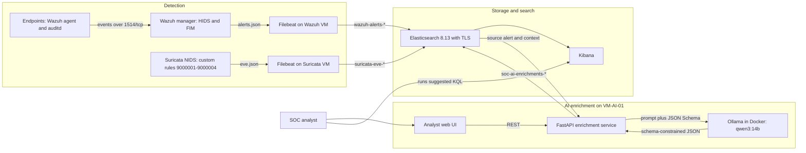
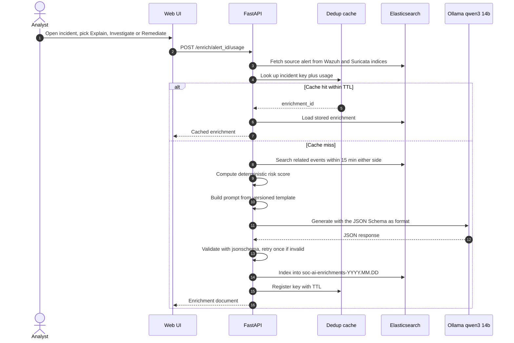

# AI-Enhanced SIEM Solution

**An on-premises LLM layer for Wazuh, Suricata and Elasticsearch that explains alerts in plain language, writes KQL to investigate them, and recommends a remediation. No alert data ever leaves your network.**


> **Status:** working MVP, built as an engineering end-of-year project (PFA). It runs as a reproducible 6-VM Vagrant lab and has been deployed on VMs in the data center of the Faculty of Sciences of Sfax. Five attack scenarios are validated end to end (detection, enrichment, persistence, UI).

---

## Table of contents

- [Overview](#overview)
- [Key features](#key-features)
- [Architecture](#architecture)
- [Attack scenarios](#attack-scenarios)
- [Results](#results)
- [Tech stack](#tech-stack)
- [Getting started](#getting-started)
- [API reference](#api-reference)
- [Project structure](#project-structure)
- [Deployment notes](#deployment-notes)
- [Limitations and roadmap](#limitations-and-roadmap)
- [Documentation](#documentation)

---

## Overview

A SOC rarely struggles to *detect* events. It struggles to *understand* them fast enough. A level-1 analyst looking at a raw Wazuh or Suricata alert sees a rule ID, a few IPs and a terse description, and has to pivot through Kibana by hand before deciding whether it is an attack and what to do about it.

This project adds a **post-detection enrichment layer** on top of an existing open-source SIEM, without changing the detection pipeline. For any alert indexed in Elasticsearch, a FastAPI service:

1. pulls the alert and every related event within ±15 minutes (same IP, host or user),
2. scores the risk with a deterministic formula (no LLM involved),
3. asks a **local LLM (Qwen3-14B served by Ollama)** for one of three analyses: *explain*, *investigate* or *remediate*,
4. forces the model's output to match a versioned JSON Schema, validates it, and stores the result back in Elasticsearch.

The model runs on the same private network as the SIEM, so the approach suits environments where security telemetry cannot be sent to a cloud API: universities, public institutions, regulated industries.

**Who it is for:** SOC teams and security engineers who run (or want to run) a Wazuh + Suricata + Elastic stack, and anyone looking for a reference design for putting an LLM into a security workflow with guardrails.

---

## Key features

- **Three AI actions per alert**
  - **Explain:** a summary, severity assessment, key IoCs, attack phase and MITRE ATT&CK technique IDs.
  - **Investigate:** 1 to 3 ready-to-paste KQL queries for Kibana, each scoped by `@timestamp`, plus a rationale.
  - **Remediate:** a primary action chosen from a fixed catalogue of 10 actions (`block_source_ip`, `isolate_host`, `escalate_to_l2`, ...), with alternatives, a justification and a confidence level.
- **Guaranteed structure:** the JSON Schema is sent to Ollama as its `format`, so generation is grammar-constrained. Every response is then re-validated with `jsonschema` (Draft 2020-12), with one retry on failure.
- **Correlated context:** related Wazuh and Suricata events within a configurable window (default ±15 min) are passed to the model, not just the single alert.
- **Deterministic risk scoring:** a 0 to 100 score from severity, occurrence count, recency and the presence of MITRE mappings, computed before any LLM call.
- **Deduplication cache:** the same incident (entity + rule + 15-minute bucket) and action is never sent to the LLM twice within the TTL (default 30 min). Repeat requests come back in milliseconds.
- **Full traceability:** every enrichment (prompt version, model, latency, validation attempts, score factors) is indexed in `soc-ai-enrichments-YYYY.MM.DD`.
- **Analyst web UI:** a risk-sorted incident list, an incident detail page with correlated context, Explain / Investigate / Remediate tabs, and a health page.
- **Fully private:** Ollama runs in Docker on the AI VM, CPU-only or with an NVIDIA GPU (auto-detected). No external API is ever called.
- **Reproducible lab:** one `Vagrantfile` provisions Elasticsearch/Kibana with TLS and API keys, the Wazuh manager and agents, Suricata with custom rules, and Filebeat shippers.

---

## Architecture

### System overview



### Enrichment pipeline

`POST /enrich/{alert_id}/{usage}` runs this flow, orchestrated by [`enrichment_service.py`](app/fastapi/app/services/enrichment_service.py):



| Stage | Module | What it does |
|---|---|---|
| Alert fetch | [`alert_service.py`](app/fastapi/app/services/alert_service.py) | Looks up the alert ID in `wazuh-alerts-*` and `suricata-eve-*` in parallel and normalizes it into an `AlertCore`. |
| Context | [`context_service.py`](app/fastapi/app/services/context_service.py) | Finds events sharing the source IP, destination IP, host or user within `CONTEXT_WINDOW_MIN`. |
| Dedup | [`dedup_service.py`](app/fastapi/app/services/dedup_service.py) | Key is `sha256(entity \| rule_id \| 15-min bucket)[:16]` plus `:usage`. In-memory with a TTL. |
| Scoring | [`scoring_service.py`](app/fastapi/app/services/scoring_service.py) | `100 × (0.4·severity + 0.3·log10(occurrences+1) + 0.2·recency_24h + 0.1·mitre_bonus)`. Categories: low < 40 ≤ medium < 70 ≤ high < 90 ≤ critical. |
| Prompt builder | [`prompt_service.py`](app/fastapi/app/services/prompt_service.py) | Injects the serialized context into [`config/ai/prompts/v1`](config/ai/prompts/v1), capped at roughly 6,000 tokens of data. |
| LLM gateway | [`llm_gateway.py`](app/fastapi/app/services/llm_gateway.py) | Async Ollama client with a concurrency semaphore, a timeout, one retry on timeout, and token/s metrics in the logs. Temperature 0.2, 8k context. |
| Output validation | [`validation_service.py`](app/fastapi/app/services/validation_service.py) | Validates against [`config/ai/schemas/v1`](config/ai/schemas/v1). After two failures the document is stored with `validated: false` and the raw output for audit. |
| Enrichment store | [`elastic_repository.py`](app/fastapi/app/repositories/elastic_repository.py) | Writes and reads `soc-ai-enrichments-*`. |

### Lab topology

Six Ubuntu 22.04 VMs on one VirtualBox host-only network (`192.168.56.0/24`), defined in the [`Vagrantfile`](Vagrantfile):

| VM | IP | Role | RAM / vCPU |
|---|---|---|---|
| `VM-WAZUH-01` | 192.168.56.10 | Wazuh manager (HIDS, FIM, active response) + Filebeat | 4 GB / 2 |
| `VM-ELK-01` | 192.168.56.20 | Elasticsearch + Kibana, CA and Filebeat API keys | 6 GB / 2 |
| `VM-SURI-01` | 192.168.56.30 | Suricata in promiscuous mode on `enp0s8` + Filebeat | 3 GB / 2 |
| `VM-AI-01` | 192.168.56.40 | Ollama + FastAPI enrichment service + UI | 6 GB / 4 |
| `VM-ENDP-01` | 192.168.56.51 | Monitored endpoint (Wazuh agent, auditd) | 1 GB / 1 |
| `VM-ENDP-02` | 192.168.56.52 | Monitored endpoint (Wazuh agent, auditd) | 1 GB / 1 |

More detail in [docs/architecture.md](docs/architecture.md).

---

## Attack scenarios

Each scenario is documented in [`data/samples/scenarios/`](data/samples/scenarios) and automated by the end-to-end test scripts. Each one must produce a detection, then three validated enrichments (explain, investigate, remediate).

| # | Scenario | Simulation | Detection | Expected enrichment |
|---|---|---|---|---|
| [S1](data/samples/scenarios/S1.md) | SSH brute force | `hydra` against SSH | Wazuh 5710 / 5712 / 5763, Suricata 9000001 | `credential_access`, T1110.001, `block_source_ip` |
| [S2](data/samples/scenarios/S2.md) | Port scan | `nmap -sS -p 1-1000` | Suricata 9000002 | `reconnaissance`, T1046 |
| [S3](data/samples/scenarios/S3.md) | File integrity change | Add, then remove, a user in `/etc/passwd` | Wazuh syscheck 550 | FIM-related explanation and remediation |
| [S4](data/samples/scenarios/S4.md) | ICMP flood | `ping -f -c 200` | Suricata 9000003 | Network flood explanation |
| [S5](data/samples/scenarios/S5.md) | Suspicious User-Agent | HTTP request with a crafted User-Agent | Suricata 9000004 | Suspicious HTTP client explanation |

---

## Results

Measured during development, as recorded in the step-by-step docs:

| Metric | Value | Source |
|---|---|---|
| Scenarios validated end to end | **5 / 5** (S1 to S5) | [`scripts/tests/`](scripts/tests), [docs/step_11test.md](docs/step_11test.md) |
| Latency of a fresh enrichment (Qwen3-14B, CPU) | **~60 to 120 s** | [docs/step_9 Endpoint.md](docs/step_9%20Endpoint.md) |
| Latency of a repeated request (dedup cache hit) | **76 ms** observed | [docs/step_9 Endpoint.md](docs/step_9%20Endpoint.md) |
| Schema validation rate with `format: "json"` only | 0%: the model returned `{}` | [docs/step_8](docs/step_8%20—%20Validation%20des%20sorties.md) |
| Schema validation rate with the JSON Schema as `format` | Validated on the first attempt for explain, investigate and remediate | [docs/step_8](docs/step_8%20—%20Validation%20des%20sorties.md) |
| Endpoint acceptance checklist (step 9) | 8 / 8 criteria passed | [docs/step_9 Endpoint.md](docs/step_9%20Endpoint.md) |

**Key lesson:** `format: "json"` only constrains JSON *syntax*. Passing the full schema, with the length and pattern constraints the llama.cpp grammar cannot enforce removed and then checked afterwards by `jsonschema`, is what made the outputs reliable.

**Analyst study (protocol ready, results pending).** [docs/evaluation.md](docs/evaluation.md) defines a counterbalanced study: 15 alerts, 2 analysts, time to understand each alert with and without enrichment, and a self-rated confidence out of 5, analysed with a Wilcoxon signed-rank test. The result tables are not filled in yet.

---

## Tech stack

| Layer | Technology |
|---|---|
| Host IDS / FIM | Wazuh manager and agent 4.x, auditd |
| Network IDS | Suricata (OISF stable PPA), custom rules plus the upstream ruleset |
| Log shipping | Filebeat 8.13.4 with per-index API keys over TLS |
| Storage and search | Elasticsearch 8.13.4 (TLS, self-generated CA), Kibana 8.13.4, ingest pipelines and index templates |
| LLM runtime | Ollama in Docker (CPU or NVIDIA GPU), model `qwen3:14b` |
| Enrichment API | Python 3.11, FastAPI 0.115, Uvicorn, Pydantic v2 / pydantic-settings, `elasticsearch[async]`, httpx, jsonschema, python-json-logger |
| UI | Static HTML + vanilla JS served by FastAPI |
| Infrastructure | Vagrant + VirtualBox, Ubuntu 22.04 (`ubuntu/jammy64`), systemd, UFW |
| Testing | pytest (unit tests), Bash + `jq` end-to-end scenario runner |

---

## Getting started

### Prerequisites

- VirtualBox 7.x and Vagrant 2.4+
- About **20 GB of free RAM, 12 vCPUs and 60 GB of disk** to run all six VMs
- No other VirtualBox VMs on `192.168.56.0/24`
- For the AI VM: Python 3.11, `jq`, and enough memory for the model (see the note below)

### 1. Bring up the lab

Order matters: ELK generates the CA and API keys that the Filebeat shippers need.

```bash
vagrant up elk              # 1. Elasticsearch + Kibana, CA, API keys, index templates
vagrant up wazuh            # 2. waits for /vagrant/certs/ca.crt before starting Filebeat
vagrant up suricata         # 3. same
vagrant up endp01 endp02    # 4. endpoints; waits for the manager on 1515/tcp
vagrant up ai               # 5. AI VM (base OS only, set up in step 2)
```

Day-to-day commands: `vagrant status`, `vagrant ssh <vm>`, `vagrant halt`, `vagrant provision <vm>`, `vagrant destroy -f`.

**Check that logs are flowing** (from `VM-ELK-01`, with `ES_PASS` set to the `elastic` password defined in [`scripts/elk/install_elk.sh`](scripts/elk/install_elk.sh)):

```bash
curl -sk -u "elastic:$ES_PASS" \
  --cacert /etc/elasticsearch/certs/ca/ca.crt \
  "https://192.168.56.20:9200/_cat/indices?v"
# after a few minutes:
# wazuh-alerts-YYYY.MM.DD    green  1  0
# suricata-eve-YYYY.MM.DD    green  1  0
```

Use `wazuh-alerts-*/_count` or `suricata-eve-*/_count` instead of `_cat/indices?v` to count documents per source.

### 2. Set up the AI VM

The `ai` VM has no automatic provisioner yet. The scripts in [`scripts/ai/`](scripts/ai) are numbered and run in order. The systemd unit and the default settings assume the repository is at `/home/vm-ai/soc-ai-lab` and that the service runs as the `vm-ai` user, as on the data-center VM. On the Vagrant VM, either create that user or adjust `PROJECT_ROOT`, the unit file and the path variables below.

```bash
vagrant ssh ai          # then switch to the vm-ai user
git clone https://github.com/yessineabdelmaksoud/AI-Enhanced-SIEM-Solution.git ~/soc-ai-lab
cd ~/soc-ai-lab

SUBNET=192.168.56.0/24 bash scripts/ai/01_firewall_ai.sh   # UFW: allow 22 and 8000 from the lab subnet
sudo bash scripts/ai/02setup_ollama_vm.sh                   # Docker + Ollama container, GPU auto-detected
bash scripts/ai/03_pull_model.sh                            # pull qwen3:14b and run a JSON smoke test
bash scripts/ai/04_benchmark_llm.sh                         # optional: 1 warm-up + 5 timed runs, P95 verdict
bash scripts/ai/05_install_fastapi.sh                       # venv + systemd unit soc-ai-fastapi
```

Notes:
- `01_firewall_ai.sh` defaults to `SUBNET=10.110.188.0/24` (the data-center network). Override it as shown for the Vagrant lab.
- When Ollama runs in the Docker container from step 02, the `ollama` CLI lives inside the container. If `03_pull_model.sh` cannot find it, pull with `sudo docker exec ollama ollama pull qwen3:14b`.
- **Memory:** the Vagrantfile gives `VM-AI-01` 6 GB of RAM, which is tight for `qwen3:14b` on CPU. Give the VM more memory, use a GPU host, or set `OLLAMA_MODEL` to a smaller model.

### 3. Configure

The service reads `/home/vm-ai/soc-ai-lab/config/.env` (and normal environment variables). Start from [`config/.env.example`](config/.env.example). That file is stored as a `cat > … << 'EOF'` shell snippet, so drop its first and last lines, then fill in the values. Copy the Elasticsearch CA (`/vagrant/certs/ca.crt` on the lab VMs) to the path given in `ES_CA_CERT`.

| Variable | Default | Description |
|---|---|---|
| `ES_HOST` | *required* | Elasticsearch URL, e.g. `https://192.168.56.20:9200` |
| `ES_USER` | *required* | Elasticsearch user |
| `ES_PASS` | *required* | Elasticsearch password (never commit it; `config/.env` is gitignored) |
| `ES_CA_CERT` | *required* | Path to the Elasticsearch CA certificate |
| `ES_INDEX_WAZUH` | `wazuh-alerts-*` | Wazuh alert index pattern |
| `ES_INDEX_SURICATA` | `suricata-eve-*` | Suricata event index pattern |
| `ES_INDEX_ENRICH` | `soc-ai-enrichments` | Prefix for enrichment indices (`-YYYY.MM.DD` is appended) |
| `OLLAMA_HOST` | *required* | Ollama URL, e.g. `http://localhost:11434` |
| `OLLAMA_MODEL` | `qwen3:14b` | Model used for every enrichment |
| `OLLAMA_TIMEOUT_S` | `180` | Per-call timeout in seconds (one retry on timeout) |
| `FASTAPI_HOST` / `FASTAPI_PORT` | `0.0.0.0` / `8000` | Bind address used by the systemd unit |
| `FASTAPI_LOG_LEVEL` | `INFO` | `DEBUG`, `INFO`, `WARNING` or `ERROR` |
| `CONTEXT_WINDOW_MIN` | `15` | Correlation window, in minutes either side of the alert |
| `DEDUP_TTL_MIN` | `30` | Lifetime of a dedup cache entry |
| `LLM_MAX_CONCURRENT` | `1` | Maximum concurrent Ollama calls (others queue) |
| `PROMPTS_DIR` | `/home/vm-ai/soc-ai-lab/config/ai/prompts/v1` | Prompt templates |
| `SCHEMAS_DIR` | `/home/vm-ai/soc-ai-lab/config/ai/schemas/v1` | Response JSON Schemas |
| `REMEDIATION_ACTIONS_PATH` | `/home/vm-ai/soc-ai-lab/config/ai/remediation_actions.json` | Allowed remediation actions |

### 4. Run

As a service (installed by `05_install_fastapi.sh`, unit in [`systemd/soc-ai-fastapi.service`](systemd/soc-ai-fastapi.service)):

```bash
sudo systemctl status soc-ai-fastapi
sudo journalctl -u soc-ai-fastapi -f
curl http://localhost:8000/health
```

Manually, for development (run from `app/fastapi` so the static UI resolves):

```bash
cd app/fastapi
python3.11 -m venv .venv && source .venv/bin/activate
pip install -r requirements.txt
uvicorn app.main:app --host 0.0.0.0 --port 8000
```

Then open `http://<ai-vm>:8000/` for the incident list, `/ui/health` for the health page, or `/docs` for the interactive OpenAPI docs.

### 5. Test

**Unit tests** (risk scoring, JSON Schemas, enrichment routes):

```bash
cd app/fastapi
pip install -r requirements-dev.txt   # runtime deps + pytest, pytest-asyncio, ruff
pytest
```

The schema tests read from `/home/vm-ai/soc-ai-lab/config/ai`, so they only pass on the AI VM or with the repository cloned at that path. The scoring tests run anywhere.

**End-to-end scenarios.** Each runner launches the attack, polls Elasticsearch for the alert, calls the three enrichments, and checks that all three are validated. The files in [`scripts/tests/`](scripts/tests) are stored wrapped in a `cat > ~/soc-ai-lab/scripts/tests/… << 'EOF'` installer. Running one writes the real runner to that path; with the repository at `~/soc-ai-lab`, it replaces the wrapper in place.

```bash
sudo apt-get install -y hydra nmap curl iputils-ping jq
printf 'admin\nroot\ntest\npassword\n123456\nqwerty\nletmein\n' > /tmp/wordlist.txt

bash scripts/tests/e2e_run_scenario.sh            # unwrap the runners
bash scripts/tests/e2e_full.sh
chmod +x ~/soc-ai-lab/scripts/tests/*.sh

~/soc-ai-lab/scripts/tests/e2e_run_scenario.sh S1   # one scenario
~/soc-ai-lab/scripts/tests/e2e_full.sh              # all five, with a latency summary
```

The runners target the data-center addresses (`ES_HOST`, `ENDPOINT` at the top of the script). Edit them for the Vagrant lab. Only run the attack scenarios against machines you own.

---

## API reference

Interactive docs: `GET /docs` (Swagger UI) and `GET /openapi.json`.

| Method | Path | Description |
|---|---|---|
| `GET` | `/health` | Elasticsearch and Ollama reachability, model and version. Returns `503` with `status: degraded` if either is down. |
| `GET` | `/incidents?hours=24&limit=50` | Recent alerts grouped by `source.ip`, scored and sorted by risk, with a `has_enrichment` flag. `hours` 1 to 168, `limit` 1 to 200. |
| `POST` | `/enrich/{alert_id}/{usage}` | Run the pipeline. `usage` is `explain`, `investigate` or `remediate`. Returns the enrichment document (`validated`, `risk_score`, `response`, `latency_ms`, `_cache_hit`, ...). `404` unknown alert, `504` LLM timeout, `502` LLM unavailable. |
| `GET` | `/enrichments/by-alert/{alert_id}` | Latest stored enrichment per usage for an alert (`{"enrichments": {"explain": {...}, "investigate": null, ...}}`). Used by the incident page to preload its tabs. |
| `GET` | `/enrichments/{enrichment_id}` | Fetch a stored enrichment. |
| `GET` | `/debug/context/{alert_id}` | The correlated context built for an alert. |
| `GET` | `/debug/prompt/{usage}/{alert_id}` | The exact prompt that would be sent, with its size and a token estimate. |
| `GET` | `/debug/remediation-actions` | The allowed remediation catalogue. |
| `POST` | `/debug/llm` | Send a raw prompt to the LLM gateway (`{"prompt": "...", "json_format": true}`). |
| `POST` | `/debug/enrich/{usage}/{alert_id}` | The same pipeline as `/enrich`, with the arguments in the other order. |
| `GET` | `/debug/enrichment/{enrichment_id}` | Fetch a stored enrichment. |
| `GET` | `/`, `/incident.html`, `/ui/health` | Analyst UI pages (assets under `/static`). |

Example:

```bash
curl -s -X POST "http://localhost:8000/enrich/$ALERT_ID/remediate" \
  | jq '{enrichment_id, validated, risk_score, risk_category, action: .response.primary_action}'
```

---

## Project structure

```
.
├── Vagrantfile                     # 6-VM lab definition
├── app/fastapi/                    # enrichment service
│   ├── app/
│   │   ├── main.py                 # app factory, lifespan wiring, static UI
│   │   ├── api/                    # routes: health, incidents, enrich, debug
│   │   ├── core/                   # settings (pydantic-settings), JSON logging
│   │   ├── models/alert.py         # AlertCore, Entity, IncidentContext, ES normalization
│   │   ├── repositories/           # async Elasticsearch repository
│   │   ├── services/               # alert, context, dedup, scoring, prompt, llm_gateway, validation, enrichment
│   │   └── static/                 # index.html, incident.html, health.html, js/, css/
│   ├── tests/                      # pytest: scoring, schemas, routes
│   ├── requirements.txt            # runtime dependencies (pinned)
│   ├── requirements-dev.txt        # + pytest, pytest-asyncio, ruff
│   └── pytest.ini
├── config/
│   ├── .env.example
│   └── ai/
│       ├── prompts/v1/             # explain / investigate / remediate templates
│       ├── schemas/v1/             # response JSON Schemas (Draft 2020-12)
│       └── remediation_actions.json
├── data/samples/
│   ├── benchmark_prompt.txt        # realistic prompt for the LLM benchmark
│   └── scenarios/                  # S1 to S5 attack scenarios
├── scripts/
│   ├── elk/                        # ES + Kibana with TLS, API keys, index templates and pipelines
│   ├── wazuh/                      # manager and agent (+ auditd rules)
│   ├── suricata/                   # Suricata + custom rules
│   ├── filebeat/                   # Wazuh and Suricata shippers
│   ├── ai/                         # 01 firewall, 02 Ollama, 03 model pull, 04 benchmark, 05 FastAPI
│   └── tests/                      # end-to-end scenario runners
├── systemd/soc-ai-fastapi.service
└── docs/                           # architecture, deployment, per-step implementation notes, evaluation
```

---

## Deployment notes

- **Two environments.** The [`Vagrantfile`](Vagrantfile) describes a self-contained lab on `192.168.56.0/24`. The data-center deployment at the Faculty of Sciences of Sfax uses the same scripts on a `10.110.188.0/24` network, with attacks launched from the AI VM against a monitored endpoint. That is why the scenario files and test runners point at `10.110.188.x`.
- **Service hardening.** The FastAPI unit runs as the unprivileged `vm-ai` user with `NoNewPrivileges` and `PrivateTmp`, restarts on failure, and logs to the journal. UFW allows only 22 and 8000 from the internal subnet.
- **Elastic security.** TLS is on for HTTP and transport, using a CA generated with `elasticsearch-certutil`. Filebeat authenticates with API keys scoped per index.
- **VM storage on another drive.** To keep the 30 to 60 GB of VM disks off your system drive (e.g. on `D:\`), see [docs/deployment.md](docs/deployment.md).
- **Lab credentials.** For reproducibility, the provisioning scripts, scenario files and several docs contain fixed lab passwords. Change them before exposing the stack anywhere other than an isolated lab.

---

## Limitations and roadmap

**Current limitations**
- The API has no authentication. Anyone who can reach port 8000 on the internal network can call it.
- The dedup cache is in memory, so it is lost on restart and not shared between workers. Stored enrichments stay in Elasticsearch.
- The Ollama container publishes 11434 on all interfaces, and Docker-published ports bypass UFW. Bind it to `127.0.0.1` when FastAPI is the only client.
- On CPU, a fresh enrichment takes about 1 to 2 minutes, and `LLM_MAX_CONCURRENT=1` serializes requests.
- Prompts and generated text are in French. Editing [`config/ai/prompts/v1`](config/ai/prompts/v1) changes the output language.
- The AI VM is set up by hand, and several paths are hard-coded to `/home/vm-ai/soc-ai-lab`.
- The analyst study in [docs/evaluation.md](docs/evaluation.md) has not been run yet.

**Roadmap**
- Add authentication (JWT or API key) and role-based access to the API and UI.
- Persist the dedup cache in Redis or Elasticsearch.
- Automate AI VM provisioning in the Vagrantfile, and make all paths configurable.
- Trigger enrichment automatically from new high-risk alerts, not only on demand.
- Run the analyst evaluation and publish the time-to-understand results.
- Move the lab credentials to a secrets store.

---

## Documentation

| Document | Content |
|---|---|
| [docs/architecture.md](docs/architecture.md) | Network plan, VM roles, ports, Suricata rules |
| [docs/deployment.md](docs/deployment.md) | Bringing the lab up, per-VM validation, common issues |
| [docs/evaluation.md](docs/evaluation.md) | Analyst evaluation protocol and statistics (FR) |
| [docs/demo_script.md](docs/demo_script.md) | 10-minute live demo walkthrough (FR) |
| `docs/step_3…` to `docs/step_11…` | Step-by-step implementation notes: health check, context, dedup and scoring, prompts, LLM gateway, validation, endpoints, UI, tests (FR) |
| [docs/roadmap.md](docs/roadmap.md) | Original roadmap and target layout |

---

Built by [Yessine Abdelmaksoud](https://github.com/yessineabdelmaksoud) · [Portfolio](https://yessineabdelmaksoud.github.io)
